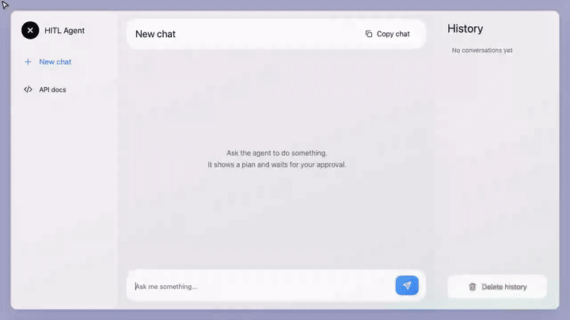
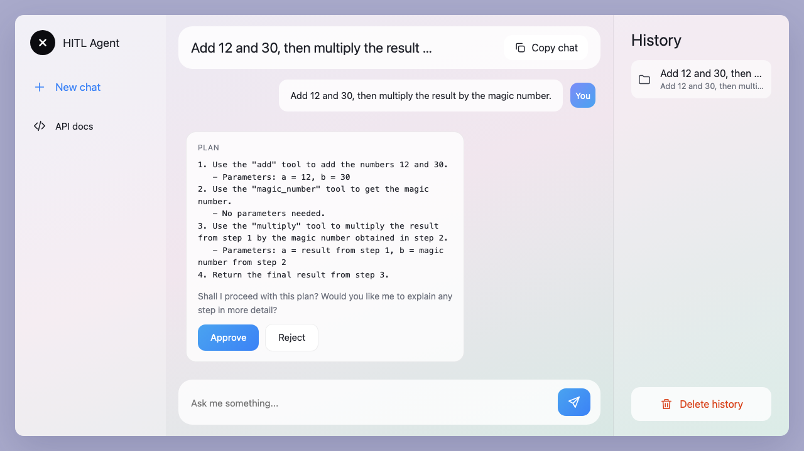
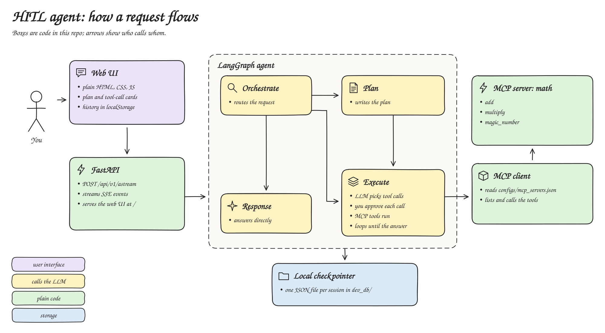
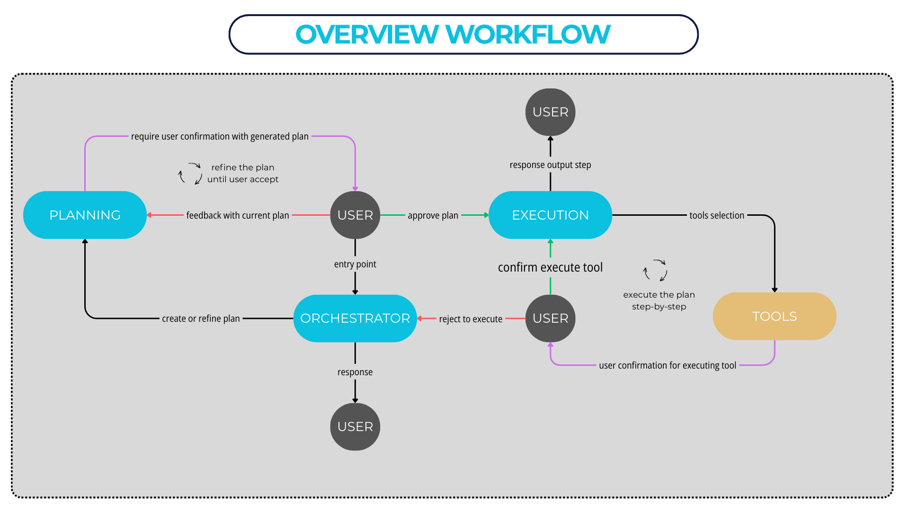

<div align="center">

# Human In The Loop Agent with MCP

**A LangGraph agent that writes a plan, asks for your approval, and runs tools over MCP.**

[](pyproject.toml)
[](LICENSE)
[](https://github.com/langchain-ai/langgraph)
[](https://fastapi.tiangolo.com/)
[](https://modelcontextprotocol.io/)

[Demo](#demo) · [Architecture](#architecture) · [Quickstart](#quickstart) · [Configuration](#configuration) · [API](#api) · [Extending](#extending) · [License](#license)

</div>

An AI agent system that combines LangGraph orchestration with Model Context Protocol (MCP) servers to add human-in-the-loop control to complex task execution. The agent plans before it acts, shows you the plan, and asks you to approve every tool call. A FastAPI backend streams progress over server-sent events (SSE) to a plain HTML, CSS and JS web UI that it serves itself.

| At a glance | |
|---|---|
| Graph nodes | 4 (Orchestrate, Plan, Execute, Response) |
| Human approval points | 2 (the plan, and each tool call) |
| Example MCP tools | 3 (`add`, `multiply`, `magic_number`) |
| Processes to start | 2 (`make mcp`, `make api`) |

## Demo

[](docs/assets/demo.mp4)

The prompt is "Add 12 and 30, then multiply the result by the magic number." The agent shows a plan, you approve it, then you approve each tool call, and the agent answers 210 (12 + 30 = 42, the magic number is 5, and 42 x 5 = 210). The animation plays at 2x speed; click it for the full MP4.



## Architecture

<p align="center"></p>

A request enters the web UI, reaches FastAPI at `POST /api/v1/astream`, and runs through a LangGraph graph whose entry point is Orchestrate. Orchestrate routes it to Plan, Execute or Response. Plan writes a plan and waits for you. Execute asks the LLM for tool calls, waits for your approval, runs the tools through the MCP client, and loops until it has an answer. A local checkpointer saves the state of each session as a JSON file in `dev_db/`.

<details>
<summary>Original workflow sketch</summary>



</details>

```
.
├── configs/mcp_servers.json    # MCP servers the agent can use
├── docs/                       # demo media, diagrams and the script that draws them
├── src/hitl_agent/
│   ├── agent/                  # LangGraph graph, nodes, states, LLM setup
│   ├── api/                    # FastAPI app, routes and request schemas
│   ├── mcp_client/             # loads tools from the configured MCP servers
│   ├── mcp_servers/math/       # example MCP server (add, multiply, magic_number)
│   ├── storage/                # local JSON checkpointer
│   ├── utils/                  # SSE formatting and MCP tool lookup
│   ├── web/                    # static web UI served at /
│   └── config.py               # settings read from .env
├── tests/
├── Makefile
└── pyproject.toml
```

<details>
<summary>Tech stack</summary>

| Area | Libraries |
|---|---|
| Agent | LangGraph, LangChain (`langchain-openai`) |
| Tools | MCP (`mcp`, `fastmcp`, `langchain-mcp-adapters`) |
| API | FastAPI, uvicorn, pydantic-settings |
| Tracing | Langfuse |
| Logging | loguru |
| Tests | pytest, httpx |

</details>

## Quickstart

Prerequisites: Python 3.10+, an OpenAI API key, and Langfuse keys (the settings require them).

1. Install: `python -m venv .venv && source .venv/bin/activate && pip install -e .`
2. Configure: `cp .env.example .env`, then fill in the four required values.
3. Run each in its own terminal: `make mcp` and `make api`, then open <http://localhost:8000>.

<details>
<summary>More</summary>

- Run everything from the repository root: `configs/mcp_servers.json` and `dev_db/` are relative paths.
- Without `make`: `python -m hitl_agent.mcp_servers.math.server` and `uvicorn hitl_agent.api.main:app --host 0.0.0.0 --port 8000`.
- Interactive API docs: <http://localhost:8000/docs>. OpenAPI schema: <http://localhost:8000/openapi.json>.
- Start `make mcp` before `make api`; the API loads the tools when it starts.
- The API only serves the web UI and the endpoint; there is no separate frontend process.

</details>

## Configuration

Settings are read from `.env` (see [`.env.example`](.env.example)).

| Variable | Description | Default |
|---|---|---|
| `OPENAI_API_KEY` | OpenAI API key (required) | - |
| `LANGFUSE_SECRET_KEY` | Langfuse secret key (required) | - |
| `LANGFUSE_PUBLIC_KEY` | Langfuse public key (required) | - |
| `LANGFUSE_HOST` | Langfuse host URL (required) | - |
| `LLM_MODEL` | OpenAI model to use | `gpt-4-mini` in code; `.env.example` sets `gpt-4.1-mini` |
| `MCP_SERVER_CONFIGS_PATH` | Path to the MCP server config | `configs/mcp_servers.json` |
| `APP_NAME` | Application name | `Human In The Loop Agent` |
| `APP_VERSION` | Application version | `1.0.0` |
| `DEBUG` | Enable debug mode | `false` |
| `LANGFUSE_DEBUG` | Enable Langfuse debug output | `false` |

<details>
<summary>MCP server configuration</summary>

Edit `configs/mcp_servers.json` to choose the MCP servers. It ships with the math server:

```json
{
  "math": {
    "url": "http://localhost:3111/mcp",
    "transport": "streamable_http"
  }
}
```

To add another server, give it its own entry, for example `"custom_server": {"url": "http://localhost:3112/mcp", "transport": "streamable_http"}`.

</details>

## API

```bash
curl -N -X POST http://localhost:8000/api/v1/astream \
  -H 'Content-Type: application/json' \
  -d '{"user_id": "me", "session_id": "demo-1", "message": "hi"}'
```

`user_id`, `session_id` and `message` are required. `messages`, `previous_node`, `current_plan` and `params` are optional. Reuse the same `session_id` for a whole conversation: the agent restores its state from the checkpoint saved for that session.

The response is a stream of `data: {...}` lines. The `type` field is one of `status`, `thinking`, `node_change`, `plan`, `message`, `complete` or `error`.

## Extending

**Add an MCP server**

1. Create `src/hitl_agent/mcp_servers/<name>/server.py`, using the math server as a template.
2. Add its URL and transport to `configs/mcp_servers.json`.
3. Restart `make api`. Tools are discovered from the configured servers when the API starts.

**Change the agent**

1. Add or edit nodes in `src/hitl_agent/agent/nodes/`.
2. Wire them in `src/hitl_agent/agent/graph.py`.
3. Change the state classes in `src/hitl_agent/agent/states/` if a node needs new fields.

To redraw the architecture diagram, edit `docs/diagrams/make_diagrams.py` and run `python docs/diagrams/make_diagrams.py` (Python 3.10+, standard library only).

## Tests

```bash
pip install -e ".[dev]" && make test
```

The tests run offline: fake keys and a stub LLM replace OpenAI. They cover module imports, serving the web UI, the tool-call approval flow and the checkpointer.

## Troubleshooting

<details>
<summary>The MCP server connection failed</summary>

The API logs `Failed to start MCP client` and keeps running without tools. Start `make mcp` first, check the URLs in `configs/mcp_servers.json`, make sure port 3111 is free, then restart `make api`.

</details>

<details>
<summary><code>FileNotFoundError</code> for <code>MCP/mcp_server_config.json</code></summary>

An older `.env` still points at the previous config path. Set `MCP_SERVER_CONFIGS_PATH=configs/mcp_servers.json` or remove the line.

</details>

<details>
<summary>OpenAI errors</summary>

Check that `OPENAI_API_KEY` is set correctly, that the key has the needed permissions and quota, and that the model in `LLM_MODEL` is available to your account.

</details>

<details>
<summary>The web UI shows "Connection error"</summary>

The UI is served by the API, so open <http://localhost:8000> and make sure `make api` is running. The console log (Loguru) shows the cause.

</details>

<details>
<summary>Langfuse errors in the log</summary>

If `LANGFUSE_HOST` is unreachable, the API logs trace-export errors but the agent keeps working.

</details>

## Contributing

1. Fork the repository.
2. Create a feature branch.
3. Make your changes.
4. Run `make test`.
5. Open a pull request.

## License

<details>
<summary>Fonts and acknowledgments</summary>

- The diagrams use the Patrick Hand font, SIL OFL 1.1, see [`docs/diagrams/OFL.txt`](docs/diagrams/OFL.txt).
- Built with [LangGraph](https://github.com/langchain-ai/langgraph), the [Model Context Protocol](https://modelcontextprotocol.io/) and [FastAPI](https://fastapi.tiangolo.com/).

</details>

Code: [MIT](LICENSE)
